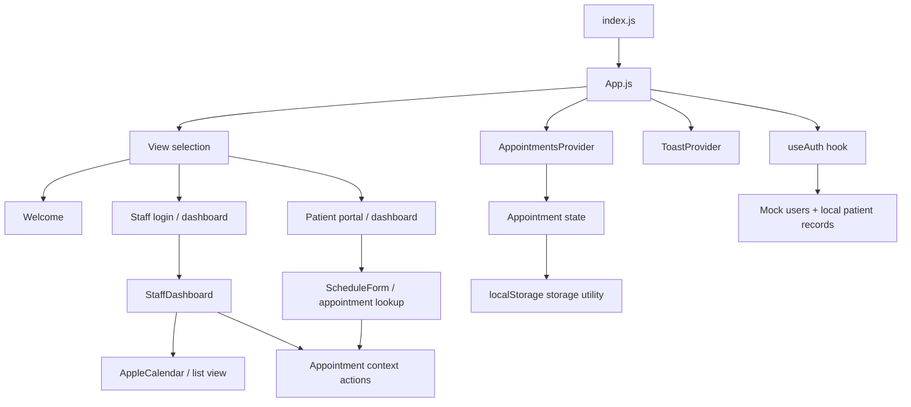

# LuminaDental

A web-based dental clinic appointment management prototype built with **React**. LuminaDental provides separate staff and patient workflows for creating, viewing, updating and managing appointments through a calendar-focused interface.

<p align="center">
  
</p>

**Author:** Anthony Frade  
**Project type:** Personal project  
**Status:** Work in progress

## Overview

LuminaDental explores how a clinic's appointment workflow can be represented in a responsive web application. It provides two main experiences:

- **Staff dashboard:** calendar and list views, appointment search and filters, sorting, pagination, status updates and appointment management.
- **Patient portal:** appointment scheduling, lookup by appointment ID or email, editing and cancellation.

The current version is a frontend prototype. It uses mock user/procedure data and browser `localStorage` for persistence; it does **not** currently include a production backend, database or API.

## Features

### Staff dashboard

- Calendar interface with month, week and day views.
- Appointment list with search by patient name, phone number or appointment ID.
- Date filters for all appointments, today, this week and this month.
- Procedure filtering and sortable appointment data.
- Pagination.
- Edit appointment details.
- Update appointment status.
- Soft-delete, restore and permanently delete appointments.

### Patient portal

- Patient registration and login using the current local demo data flow.
- Create an appointment request.
- Look up an appointment by email or appointment ID.
- Edit appointment date, time and address.
- Cancel an appointment.

### User experience

- Separate staff and patient flows.
- Animated page transitions with Framer Motion.
- Toast notifications.
- Procedure colour coding across calendar and appointment views.
- Responsive layout and reusable UI components.
- Lucide icons.

## Technology stack

| Technology | Role |
|---|---|
| React 19 | Component-based application UI |
| JavaScript | Application and interaction logic |
| CSS Modules / CSS | Component and page styling |
| Framer Motion | Page transition animations |
| Lucide React | Interface icons |
| Browser `localStorage` | Demo persistence for appointments and patient records |
| Create React App (`react-scripts`) | Development server and production build |

## Architecture

The application is organised around a root React component, page-level views, shared context providers, custom hooks, mock data and utility functions.



### Application entry and view routing

- `src/index.js` mounts the React application.
- `src/App.js` is the application coordinator. It stores the current view, reads the authenticated user from `useAuth`, and chooses the staff or patient experience based on the user's role.
- `AnimatePresence` and `motion` from Framer Motion animate view transitions.
- `ToastProvider` and `AppointmentsProvider` wrap the application and expose shared UI feedback and appointment state.

The project uses view state in `App.js` to switch between pages rather than a dedicated routing library.

### Authentication and roles

`src/hooks/useAuth.js` provides the `useAuth` hook. It supports separate staff and patient login flows:

- Staff accounts are checked against `MOCK_USERS`.
- Patient records are loaded from browser `localStorage`.
- Patient registration stores a new patient record locally.
- The current user role determines whether the staff dashboard or patient dashboard is rendered.

**Security limitation:** this is demo authentication, not production authentication. Credentials and patient records are handled client-side and must not be used for real patient data or real clinic operations.

### Appointment state and persistence

`src/context/appointmentconttext.js` provides the `AppointmentsProvider` and `useAppointments` hook.

The context centralises appointment operations:

- Add and update appointments.
- Find an appointment by ID.
- Find appointments by email.
- Update appointment status.
- Add notes.
- Soft-delete and restore appointments.
- Permanently delete appointments.

Initial appointment data comes from `src/data/appointment.js`. The provider persists state using the helpers in `src/utilis/storage.js`, which serialise the appointment state to browser `localStorage`.

### Staff calendar and dashboard

`src/pages/staffDashBoard/staffDashBoard.js` coordinates the staff interface. It uses the shared appointment context and provides calendar/list modes, filters, sorting, pagination and editing.

The calendar is split into reusable components under `src/components/appleCalendar/`:

- `AppleCalendar.js`
- `MonthView.js`
- `WeekView.js`
- `DayView.js`

### Patient scheduling

The patient portal is implemented under `src/pages/patientPortal/`:

- `patientPortal.js` switches between scheduling and appointment lookup/edit flows.
- `ScheduleForm.js` collects appointment details.
- `PatientDashboard.js` provides the patient-facing dashboard view.

### Supporting modules

- `src/data/` contains mock users, appointments and procedure definitions.
- `src/hooks/` contains authentication and appointment-related hooks.
- `src/context/` contains shared appointment and toast contexts.
- `src/utilis/` contains storage, date, colour and validation helpers.

## Project structure

The application itself is located inside `LuminaDental/luminadental/`.

```text
Lumina-dental/
├── README.md
├── LuminaDentalGif.gif
├── LuminaDental.mp4
└── LuminaDental/
    └── luminadental/
        ├── package.json
        ├── public/
        └── src/
            ├── components/
            │   ├── appleCalendar/
            │   ├── appointmentForm/
            │   ├── calendar/
            │   ├── button/
            │   └── input/
            ├── context/
            ├── data/
            ├── hooks/
            ├── pages/
            │   ├── landingPage/
            │   ├── loginPage/
            │   ├── patientPortal/
            │   └── staffDashBoard/
            ├── utilis/
            ├── App.js
            ├── App.css
            └── index.js
```

## Demo

- [Watch the demo video](LuminaDental.mp4)
- The animated preview is shown at the top of this README.

## Getting started

### Requirements

- Node.js
- npm

### Install dependencies

Clone the repository and enter the React application directory:

```bash
git clone https://github.com/nyfrade/Lumina-dental.git
cd Lumina-dental/LuminaDental/luminadental
npm install
```

### Start the development server

```bash
npm start
```

The application normally opens at `http://localhost:3000`.

### Create a production build

```bash
npm run build
```

## Current limitations and next steps

The current implementation is a frontend prototype and has known limitations:

- No backend API or database; appointment data is stored in the browser.
- Staff accounts and procedures use mock data.
- Patient authentication is implemented locally and is not secure for real-world use.
- Data is tied to the browser/device and is not shared between users or devices.
- Automated test coverage is limited.
- Some UI and calendar edge cases remain to be refined.
- Accessibility, validation and error handling need further review.

Potential next steps include introducing a backend API and database, implementing secure role-based authentication, adding server-side appointment validation and conflict detection, and expanding automated tests.

## Credits

**Author:** Anthony Frade

---

LuminaDental is a learning and portfolio project. It is not intended for handling real patient information or operating a real dental clinic.
